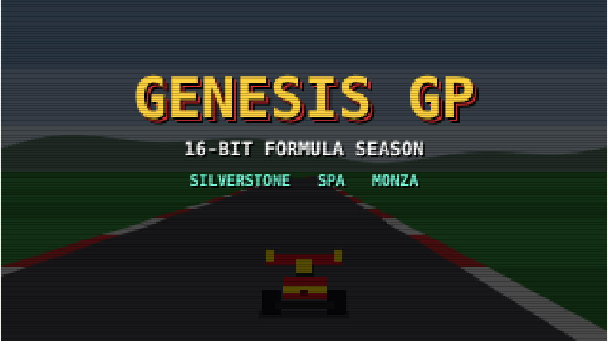
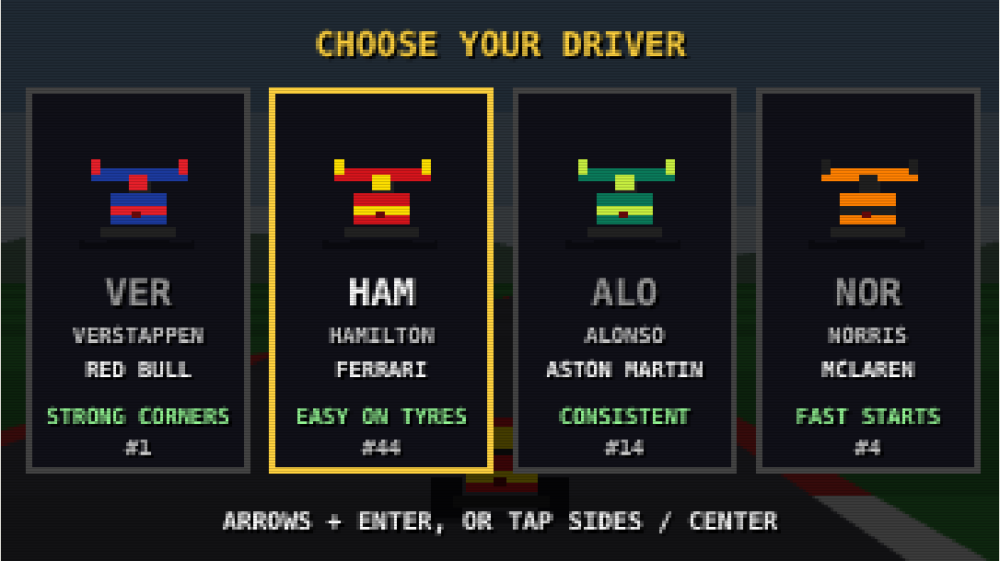
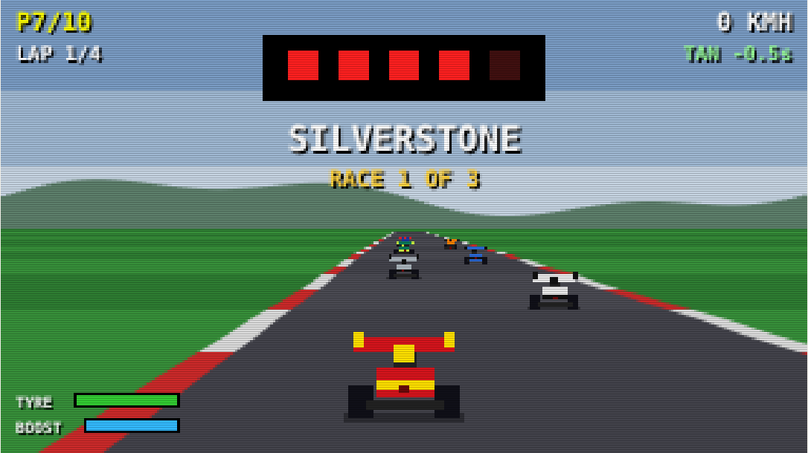
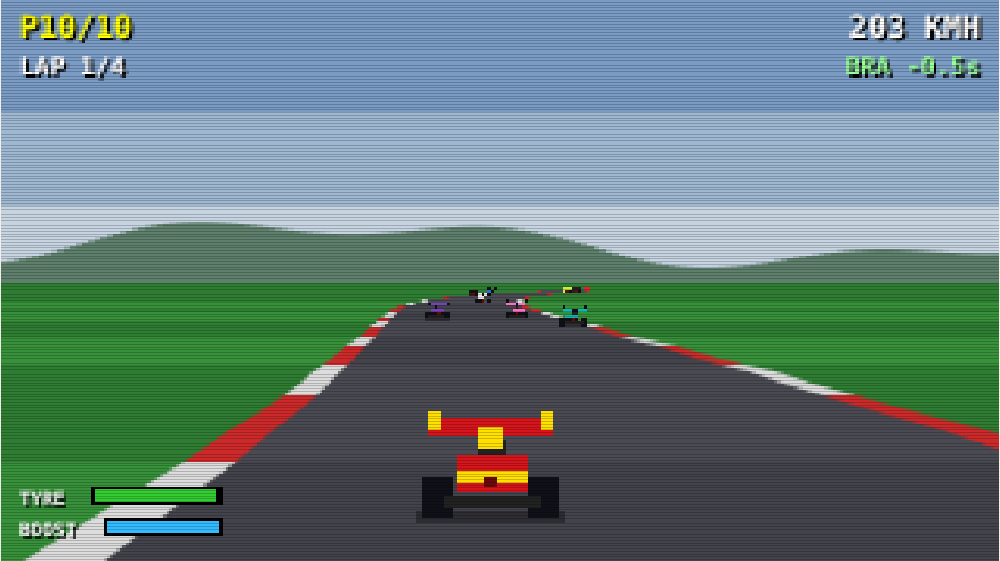
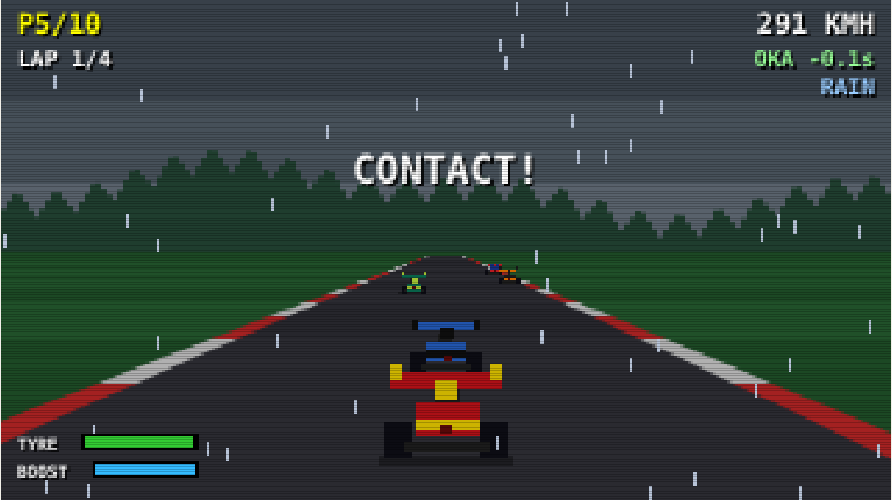
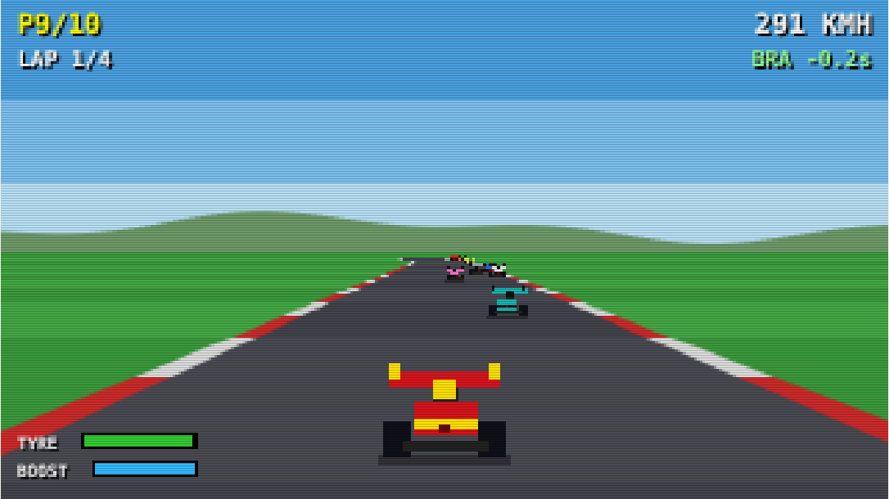
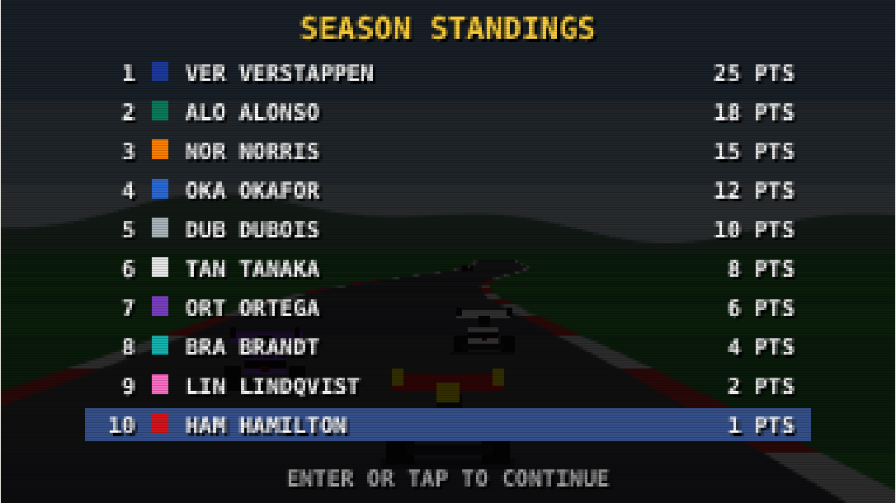

# Genesis GP

A browser Formula 1 racing game styled like a 1990s Sega Genesis title. Pick one of four drivers, line up on a ten-car grid and fight through a three-race season at Silverstone, Spa-Francorchamps and Monza. Four laps per race, rain at Spa, and tires that give up on you if you drive like a maniac.

**Play it:** https://andyshearsphd.github.io/Formula-Genesis/ (or open `index.html` in any modern browser).

## Screenshots

| | |
|---|---|
|  |  |
| Choose your driver | Start lights at the grid |
|  |  |
| Chasing the pack at Silverstone | Rain and contact at Spa |
|  |  |
| Flat out at Monza | Season standings after a race |

## Controls

**Keyboard**
- Left and Right arrows (or A and D): steer
- Up arrow (or W): gas
- Down arrow (or S): brake
- Space (or Shift, or B): overtake boost
- Enter: confirm in menus
- M: mute

**Phone:** on-screen buttons for steer, gas, brake and boost appear automatically. Tap the screen to move through the menus.

## Features

- Four drivers, each with a small edge: Verstappen (Red Bull) is strongest in corners, Hamilton (Ferrari) is easiest on tires, Alonso (Aston Martin) is the most forgiving in slides, and Norris (McLaren) gets the quickest starts
- A three-race season: Silverstone, then Spa-Francorchamps in the rain, then Monza
- Pseudo-3D chase view with hills, curves, curbs and a limited, chunky 16-bit look with scanlines
- Tire wear that slowly costs you grip and makes the car twitchy, and wears faster when you brake hard, slide, hit the curbs or run wide
- No pit stops and no DRS: instead, an overtake boost on a meter that recharges faster when you sit close behind another car
- A ten-car grid with AI that attacks, defends and makes the occasional mistake
- Real F1 points, results and standings after every race, and a champion screen at the end of the season
- Season progress saves in your browser, with a Continue option on the title screen
- Chiptune-style music and engine sound, all generated in code

## Notes

Everything is in one self-contained HTML file with no dependencies. Graphics and sound are generated in code. Season progress is stored in your browser's local storage, so it stays on the device and address you played on.

The track layouts are stylized and simplified, not exact maps. The cars use team-color approximations with no logos. This is a fan-made tribute, not affiliated with Formula 1 or any team or driver. The six other drivers on the grid are fictional.
